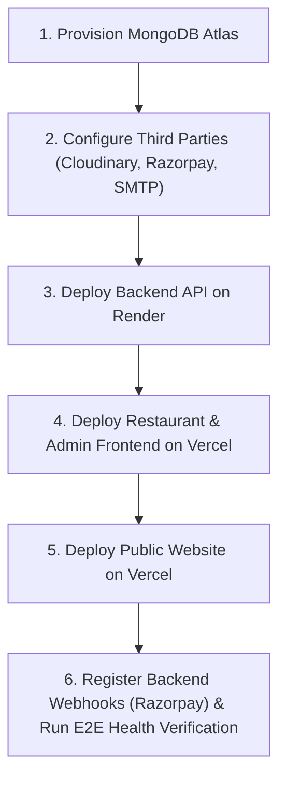

# Craviti — Production Deployment & Environment Guide

Welcome to the definitive deployment guide for the Craviti platform. This document outlines the end-to-end architecture, environment configuration, provisioning sequence, and operation runbooks for deploying Craviti to production across **Render**, **Vercel**, and **MongoDB Atlas**.

---

## Architecture Overview

```
                      ┌──────────────────────────────────────┐
                      │            PUBLIC TRAFFIC            │
                      └──────────────────┬───────────────────┘
                                         │
                   ┌─────────────────────┴────────────────────┐
                   ▼                                          ▼
     ┌───────────────────────────┐              ┌───────────────────────────┐
     │      Public Website       │              │     Restaurant & Admin    │
     │    (Next.js on Vercel)    │              │      (Vite on Vercel)     │
     │    https://craviti.com    │              │  https://cravti.vercel.app│
     └─────────────┬─────────────┘              └─────────────┬─────────────┘
                   │                                          │
                   │ REST / Health                            │ REST / Socket.io
                   └─────────────────────┬────────────────────┘
                                         ▼
                        ┌─────────────────────────────────┐
                        │      Craviti API Backend        │
                        │       (Node.js on Render)       │
                        │   https://cravti.onrender.com   │
                        └────────┬──────────────┬─────────┘
                                 │              │
                   ┌─────────────┴──────┐ ┌─────┴──────────────┐
                   ▼                    ▼ ▼                    ▼
     ┌───────────────────────┐ ┌───────────────┐ ┌───────────────────────────┐
     │     MongoDB Atlas     │ │   Cloudinary  │ │   Razorpay Payment Gateway│
     │  (Replica Set Cluster)│ │ (Media Assets)│ │  (Webhooks & Transactions)│
     └───────────────────────┘ └───────────────┘ └───────────────────────────┘
```

---

## 1. Centralized Environment Configuration Architecture

Craviti implements a strict **single-source-of-truth configuration pattern**:
- **Zero Direct Variable Access**: Application code never touches raw `process.env` or `import.meta.env` directly.
- **Boot Validation**: The backend validates critical variables on startup (`backend/src/config/validateEnv.js`) and halts booting with formatted errors if mandatory variables are missing.
- **Frozen Config Singletons**:
  - Backend: `backend/src/config/env.js` (Object.freeze)
  - Frontend: `frontend/src/config/env.js` (Object.freeze)
  - Admin: `admin/src/config/env.js` (Object.freeze)
  - Public Website: `public_website/config/env.ts` (Object.freeze)
- **Zero Secrets Committed**: All real credentials remain strictly in `.env` files (excluded by `.gitignore`). Only `.env.example` templates with descriptive placeholders are tracked in source control.

---

## 2. Deployment Sequence

Always deploy services in this strict operational order:



---

## 3. Database Setup (MongoDB Atlas)

1. Create or log in to your account at [cloud.mongodb.com](https://cloud.mongodb.com).
2. Create an **M0 (Free)** or **M10+ (Production)** cluster in the cloud region nearest to your customers (e.g., `AWS ap-south-1 Mumbai`).
3. Under **Database Access**, create a database user:
   - Username: `craviti_app`
   - Password: `<GENERATE_A_STRONG_RANDOM_PASSWORD>`
   - Role: `readWriteAnyDatabase`
4. Under **Network Access**, allow access from Render:
   - For Render IP flexibility, add `0.0.0.0/0` (Allow Access from Anywhere) or Render static outbound IP addresses.
5. Click **Connect** &rarr; **Drivers** (Node.js) &rarr; Copy connection string:
   ```text
   mongodb+srv://craviti_app:<password>@craviti-cluster.xxxxx.mongodb.net/craviti?retryWrites=true&w=majority&appName=Craviti
   ```

---

## 4. Third-Party Integrations Setup

### A. Cloudinary (Menu Item Images)
1. Register at [cloudinary.com](https://cloudinary.com).
2. Go to your **Dashboard**.
3. Record:
   - **Cloud Name**: (e.g., `craviti-media`)
   - **API Key**: (e.g., `123456789012345`)
   - **API Secret**: (keep secure)

### B. Razorpay (Online Payments)
1. Log in to the [Razorpay Dashboard](https://dashboard.razorpay.com).
2. Navigate to **Settings** &rarr; **API Keys**.
3. Generate **Test** or **Live** Key ID and Secret:
   - Key ID format: `rzp_test_...` or `rzp_live_...`
   - Key Secret: Keep confidential.
4. Under **Settings** &rarr; **Webhooks**, add webhook URL:
   - **Webhook URL**: `https://cravti.onrender.com/api/payment/webhook`
   - **Secret**: `<STRONG_RANDOM_STRING>` (assign to `RAZORPAY_WEBHOOK_SECRET`)
   - **Events to Select**:
     - `payment.authorized`
     - `payment.captured`
     - `payment.failed`
     - `order.paid`

### C. SMTP Email (Order Receipts & Notifications)
- **Host**: `smtp.gmail.com` (or SendGrid, AWS SES)
- **Port**: `587`
- **User**: Your authenticated email address
- **Password**: Google App Password (16 characters without spaces)

---

## 5. Render Backend API Deployment

1. Log in to [dashboard.render.com](https://dashboard.render.com).
2. Click **New +** &rarr; **Web Service**.
3. Connect your GitHub repository (`subham3das/CRAVTI`).
4. Set service details:
   - **Name**: `craviti-api`
   - **Region**: `Singapore` or `Frankfurt` (closest to your audience)
   - **Root Directory**: `backend`
   - **Runtime**: `Node`
   - **Build Command**: `npm install`
   - **Start Command**: `node src/server.js`
   - **Instance Type**: `Starter` ($7/mo) or `Free`
5. Under **Advanced** &rarr; **Health Check Path**:
   - Set to: `/health`
6. Add **Environment Variables** in Render:

| Variable | Recommended Production Value | Description |
|---|---|---|
| `NODE_ENV` | `production` | Enables production caching and disables dev logs |
| `PORT` | `10000` (Render sets automatically) | Listening HTTP port |
| `TZ` | `Asia/Kolkata` | Standard operational timezone |
| `MONGO_URI` | `mongodb+srv://...` | MongoDB Atlas URI |
| `JWT_SECRET` | *(64-char random hex)* | Token cryptographic signing secret |
| `JWT_EXPIRES_IN` | `30d` | JWT lifetime |
| `CLIENT_URL` | `https://cravti.vercel.app` | Restaurant frontend origin |
| `ADMIN_CLIENT_URL` | `https://cravti.vercel.app` | Admin panel origin |
| `SOCKET_CORS_ORIGIN` | `https://cravti.vercel.app` | Allowed WebSocket origin |
| `RAZORPAY_KEY_ID` | `rzp_live_...` | Razorpay Merchant Key ID |
| `RAZORPAY_KEY_SECRET` | *(Razorpay Secret)* | Razorpay Secret Key |
| `RAZORPAY_WEBHOOK_SECRET` | *(Random Secret)* | Matching webhook verification secret |
| `RAZORPAY_MODE` | `live` | Live or test payment processing |
| `CLOUDINARY_CLOUD_NAME` | `craviti-media` | Cloudinary storage identifier |
| `CLOUDINARY_API_KEY` | *(Key)* | Cloudinary API Key |
| `CLOUDINARY_API_SECRET` | *(Secret)* | Cloudinary API Secret |
| `SMTP_HOST` | `smtp.gmail.com` | Outgoing email server |
| `SMTP_PORT` | `587` | Outgoing email port |
| `SMTP_SECURE` | `false` | TLS negotiation |
| `SMTP_USER` | `notifications@craviti.com` | SMTP account |
| `SMTP_PASS` | *(Google App Password)* | SMTP credentials |
| `EMAIL_FROM` | `Craviti <orders@craviti.com>` | Sender address header |

---

## 6. Vercel Restaurant & Admin Frontend Deployment

The frontend package houses both the restaurant operations panel and the admin superconsole under a unified, performant Vite application.

1. Log in to [vercel.com](https://vercel.com) &rarr; **Add New...** &rarr; **Project**.
2. Import repository `subham3das/CRAVTI`.
3. Configure project:
   - **Framework Preset**: `Vite`
   - **Root Directory**: `frontend`
   - **Build Command**: `npm run build`
   - **Output Directory**: `dist`
   - **Install Command**: `npm install`
4. Add **Environment Variables**:

| Variable | Production Value | Description |
|---|---|---|
| `VITE_API_BASE_URL` | `https://cravti.onrender.com/api` | Backend API base URL |
| `VITE_SOCKET_URL` | `https://cravti.onrender.com` | Backend Socket.IO URL |
| `VITE_RAZORPAY_KEY_ID` | `rzp_live_...` | Public Razorpay Key ID |
| `VITE_APP_NAME` | `Craviti` | Platform application name |
| `VITE_APP_ENV` | `production` | Environment name |
| `VITE_PAYMENT_PROVIDER` | `razorpay` | Active gateway selector |
| `VITE_SUPPORT_EMAIL` | `support@craviti.com` | Helpdesk contact |

5. Deploy.

---

## 7. Vercel Public Marketing Website Deployment

1. In [vercel.com](https://vercel.com), click **Add New...** &rarr; **Project**.
2. Import repository `subham3das/CRAVTI`.
3. Configure project:
   - **Framework Preset**: `Next.js`
   - **Root Directory**: `public_website`
   - **Build Command**: `npm run build`
   - **Output Directory**: `.next`
   - **Install Command**: `npm install`
4. Add **Environment Variables**:

| Variable | Production Value | Description |
|---|---|---|
| `NEXT_PUBLIC_API_URL` | `https://cravti.onrender.com/api` | Backend API endpoint |
| `NEXT_PUBLIC_SOCKET_URL` | `https://cravti.onrender.com` | Real-time notification endpoint |
| `NEXT_PUBLIC_WEBSITE_URL` | `https://craviti.com` | Canonical public marketing URL |
| `NEXT_PUBLIC_APP_URL` | `https://cravti.vercel.app` | Restaurant application link |
| `NEXT_PUBLIC_ADMIN_URL` | `https://cravti.vercel.app/admin/login` | Admin portal link |
| `NEXT_PUBLIC_SUPPORT_EMAIL` | `support@craviti.com` | Inbound support inbox |
| `NEXT_PUBLIC_PHONE` | `+91 (800) 272-8484` | Inbound customer care phone |

5. Deploy.

---

## 8. Custom Domains & SSL Setup

### A. Vercel (Frontend & Public Website)
1. In Vercel Project &rarr; **Settings** &rarr; **Domains**.
2. Add your custom domains:
   - Marketing site: `craviti.com` and `www.craviti.com`
   - App: `app.craviti.com`
3. Configure DNS records at your domain registrar (e.g., Cloudflare, GoDaddy, Namecheap):
   - For Apex (`craviti.com`): `A` record pointing to `76.76.21.21`
   - For Subdomains (`app.craviti.com`): `CNAME` record pointing to `cname.vercel-dns.com`
4. Vercel automatically provisions and renews Let's Encrypt SSL certificates.

### B. Render (Backend API)
1. In Render Web Service &rarr; **Settings** &rarr; **Custom Domains**.
2. Add `api.craviti.com`.
3. Add DNS record at your domain registrar:
   - `CNAME` for `api` pointing to `cravti.onrender.com`
4. Render automatically manages SSL generation and renewals.

---

## 9. Production Health & Verification Checklist

Once deployed, verify each checkpoint:

```bash
# 1. Verify Root Endpoint
curl -i https://cravti.onrender.com/
# Expect: 200 OK with { "success": true, "status": "Healthy" }

# 2. Verify Health Status & Database Connectivity
curl -i https://cravti.onrender.com/health
# Expect: 200 OK with database: "Connected"

# 3. Verify Liveness Endpoint
curl -i https://cravti.onrender.com/live
# Expect: 200 OK with alive: true

# 4. Verify Readiness Endpoint
curl -i https://cravti.onrender.com/ready
# Expect: 200 OK with ready: true
```

---

## 10. Operational Runbooks

### Runbook A: Production Secret Rotation
When rotating `JWT_SECRET`, `RAZORPAY_KEY_SECRET`, or `MONGO_URI`:
1. Generate new cryptographically secure secrets:
   ```bash
   node -e "console.log(require('crypto').randomBytes(32).toString('hex'))"
   ```
2. In Render dashboard, update the environment variable.
3. Render automatically initiates a zero-downtime rolling restart.
4. If rotating `JWT_SECRET`, note that existing active sessions will be invalidated and users will need to re-login.

### Runbook B: Adding a New Environment Variable
1. Add the variable documentation and dummy placeholder to:
   - `backend/.env.example`, `frontend/.env.example`, or `public_website/.env.example`
2. Update the validator in `backend/src/config/validateEnv.js` if it is a mandatory backend variable.
3. Add the property to the central frozen configuration file:
   - Backend: `backend/src/config/env.js`
   - Frontend: `frontend/src/config/env.js`
   - Public Website: `public_website/config/env.ts`
4. Reference the variable ONLY via the frozen `env` object. Never access `process.env` directly.
5. Update this `DEPLOYMENT.md` guide and the hosting platforms (Render/Vercel dashboard).
